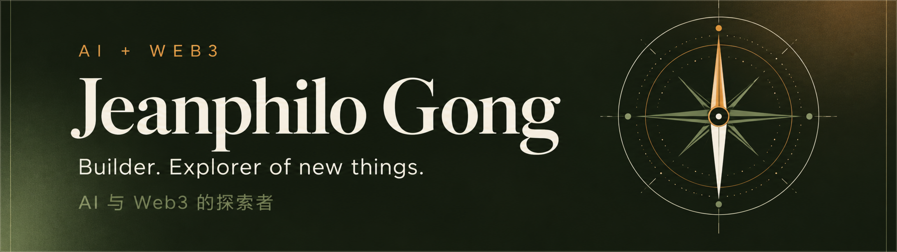
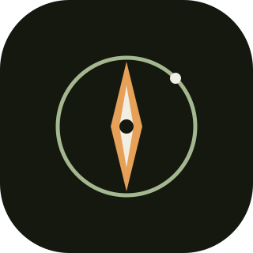
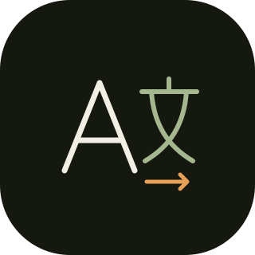
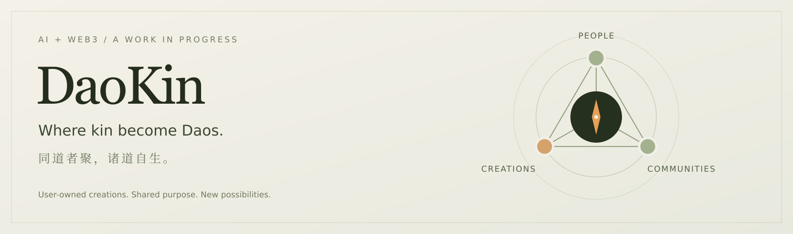

  

Building AI + Web3 products. Exploring research tools and developer workflows.

Currently building <a href="https://github.com/JeanphiloGong/daokin"><strong>DaoKin</strong></a> — experiments in user-owned creations and communities.

  <a href="https://jeanphilogong.github.io/jeanblog/"> Blog</a>
  &nbsp;&nbsp;
  <a href="mailto:xiao67004@gmail.com"> xiao67004@gmail.com</a>
  &nbsp;&nbsp;
  <a href="https://github.com/JeanphiloGong?tab=repositories"> Projects</a>
  &nbsp;&nbsp;
  <a href="https://t.me/Jeanphilo"> Telegram · @Jeanphilo</a>

## Selected work

<table width="100%">
  <tr>
    <td width="88">
      
    </td>
    <td>
      <a href="https://github.com/JeanphiloGong/daokin"><strong>DaoKin</strong></a> 
      AI + Web3 for user-owned creations and communities. Where kin become Daos. 
      <code>Early prototype</code> · SvelteKit / Go / Solidity
    </td>
  </tr>
  <tr>
    <td>
      
    </td>
    <td>
      <a href="https://github.com/JeanphiloGong/tsingai-lens"><strong>Lens</strong></a> 
      Compare results across papers and trace research findings back to their sources. 
      <code>In development</code> · Materials science first
    </td>
  </tr>
  <tr>
    <td>
      
    </td>
    <td>
      <a href="https://github.com/JeanphiloGong/Agents-spec"><strong>Agents-spec</strong></a> 
      Role-based AGENTS.md specs, Codex Skills, and reusable workflows for coding agents. 
      <code>Specs &amp; skills</code> · Developer workflows
    </td>
  </tr>
  <tr>
    <td>
      
    </td>
    <td>
      <a href="https://github.com/JeanphiloGong/ai-translator"><strong>AI Translator</strong></a> 
      English and Japanese translation, grammar notes, and a local history for everyday learning. 
      <code>CLI + API</code> · Python / FastAPI / SQLite
    </td>
  </tr>
</table>

  

